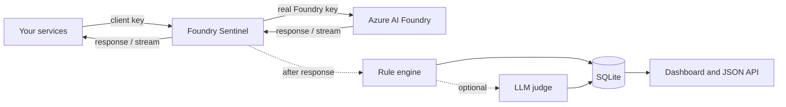

# Foundry Sentinel

**A diagnostic gateway for Azure AI Foundry.** Sentinel sits between your applications and Azure AI Foundry. It forwards every model and agent call unchanged and then checks each one. It tells you **what is wrong with the agent** and **how to fix it**, for example:

- a system prompt that is being overwritten
- a context window that is filling up
- contradictory instructions
- prompt injection hidden in retrieved documents
- prompts that break caching

Sentinel can also hold your Foundry key centrally. Your services call Sentinel with their own client keys and never see the real Foundry credential.

---

## Contents

1. [Why Sentinel](#why-sentinel)
2. [How it works](#how-it-works)
3. [Features](#features)
4. [Quick start (local laptop)](#quick-start-local-laptop)
5. [Connecting your services](#connecting-your-services)
6. [Authentication model](#authentication-model)
7. [What Sentinel detects](#what-sentinel-detects)
8. [Health score](#health-score)
9. [LLM judge (optional)](#llm-judge-optional)
10. [Dashboard](#dashboard)
11. [HTTP API](#http-api)
12. [Configuration reference](#configuration-reference)
13. [Deployment](#deployment)
14. [Security and privacy](#security-and-privacy)
15. [Limitations](#limitations)
16. [Troubleshooting](#troubleshooting)
17. [Project structure](#project-structure)
18. [Testing](#testing)
19. [Extending Sentinel](#extending-sentinel)

---

## Why Sentinel

Agents rarely fail loudly. They get slowly worse, for reasons like these:

- A framework adds a second system message, and your carefully written prompt quietly loses.
- An Agent run passes `instructions`, which **replaces** the agent's saved prompt instead of adding to it.
- Conversation history and RAG chunks pile up until the context window is 90% full. Quality drops, cost rises, and eventually the call fails.
- A retrieved web page contains "ignore all previous instructions", and the model obeys.
- A timestamp at the top of the system prompt stops prompt caching from ever working.

None of these show up as errors in Azure. Sentinel makes them visible on every request, with a concrete fix for each.

---

## How it works



1. **Forward.** Sentinel passes each request to your Foundry resource exactly as received. It swaps the caller's key for the real one if you configured one. Responses, including streamed ones, are relayed back to the caller as they arrive.
2. **Normalize.** After the response is sent, the request is converted into one common shape: messages, instructions, tools, model and token usage. This works the same for all four Foundry APIs.
3. **Diagnose.** Nineteen deterministic rules inspect the request and response. Each finding has a severity, an explanation, evidence and a suggested fix.
4. **Review (optional).** A small LLM reviews the flagged requests and writes a plain-language diagnosis, plus an improved system prompt.
5. **Report.** Results are stored in SQLite and shown on the dashboard and the JSON API.

Analysis happens **after** the response has been returned, so it adds no latency to your application. Sentinel's own forwarding overhead is typically 1–5 ms.

---

## Features

| Area | What you get |
|---|---|
| Coverage | Azure OpenAI chat completions, Azure AI Inference, the Responses API, and the Foundry Agent Service (agents, threads, messages, runs, run polling, tool outputs) |
| Streaming | Server-sent event streams are relayed live, then analysed once the stream ends |
| Key management | One real Foundry key held by Sentinel; separate client keys per team or service |
| Diagnostics | 19 rules covering prompt overwrites, context size, contradictions, injection, caching, tools, truncation and errors |
| Token accounting | A breakdown of where input tokens go (system, history, latest user turn, tool outputs, tool schemas), checked against Azure's real usage |
| Prioritisation | A health score per request and a ranked "What to fix first" list across all traffic |
| LLM judge | Optional review by a cheap model, with explanations, fixes and a rewritten system prompt |
| CI linting | Check a prompt without calling Azure, to block bad prompts before deployment |
| Traceability | Every response carries an `x-sentinel-request-id` header that links your app's logs to the analysis |
| Per-app views | Label callers with the `x-sentinel-app` header and compare health per service or agent |

---

## Quick start (local laptop)

**Requirements:** Python 3.10 or newer, and an Azure AI Foundry or Azure OpenAI resource with a deployed model.

### 1. Install

```bash
cd foundry-sentinel
python3 -m venv .venv
source .venv/bin/activate          # Windows: .venv\Scripts\activate
pip install -r requirements.txt
```

### 2. Configure

Copy `.env.example` to `.env` and fill in these values:

| Setting | Value |
|---|---|
| `SENTINEL_UPSTREAM_URL` | The **base** URL of your resource only, for example `https://my-resource.openai.azure.com` or `https://my-resource.services.ai.azure.com`. Leave out `/openai/deployments/...`. |
| `SENTINEL_UPSTREAM_API_KEY` | Your Foundry or Azure OpenAI key (found under **Keys and Endpoint** in the portal) |
| `SENTINEL_CLIENT_KEYS` | Comma-separated keys you make up for your services, for example `team-a-key,team-b-key` |
| `SENTINEL_ADMIN_TOKEN` | A password for the dashboard |

### 3. Start

```bash
python run_sentinel.py
```

Sentinel listens on `http://localhost:8080`. Run this from the `foundry-sentinel` folder, the one that contains `run_sentinel.py`, `requirements.txt` and the `sentinel` subfolder. `sentinel` is a folder (a Python package), not a `sentinel.py` file. `python -m sentinel` also works, but only from that same project folder.

### 4. Try it

In a second terminal, run the bundled test client. It sends three requests: one healthy, one with an overwritten prompt, and one with an injected instruction. For each, it prints the answer followed by Sentinel's diagnosis.

```bash
export FOUNDRY_DEPLOYMENT=<your deployment name>
export SENTINEL_CLIENT_KEY=team-a-key
export SENTINEL_ADMIN_TOKEN=<your admin token>
python examples/call_foundry_via_sentinel.py --demo
```

Then open the dashboard at `http://localhost:8080/sentinel?token=<your admin token>`.

---

## Connecting your services

Each service changes **only its endpoint and key**: point it at Sentinel instead of Azure, and use a Sentinel client key instead of the Foundry key. Prompts, models and request bodies stay the same.

| Client | Endpoint setting | Before | After |
|---|---|---|---|
| OpenAI SDK, `AzureOpenAI` | `azure_endpoint` | `https://res.openai.azure.com` | `http://<sentinel-host>:8080` |
| OpenAI SDK, `OpenAI` (v1 surface / Responses API) | `base_url` | `https://res.openai.azure.com/openai/v1/` | `http://<sentinel-host>:8080/openai/v1/` |
| Azure AI Inference, `ChatCompletionsClient` | `endpoint` | `https://res.services.ai.azure.com/models` | `http://<sentinel-host>:8080/models` |
| Agent Service, `AgentsClient` / `AIProjectClient` | `endpoint` | `https://res.services.ai.azure.com/api/projects/<p>` | `http://<sentinel-host>:8080/api/projects/<p>` |
| Raw HTTP, LangChain, Semantic Kernel, and others | base URL | your Azure host | the Sentinel host, same path |

**Key:** pass a Sentinel client key wherever the SDK expects the API key.

**Labelling (recommended):** add the header `x-sentinel-app: <service-name>`. Most SDKs accept default headers when the client is created. Without this header, traffic is grouped under `default`.

**From other machines:** use your laptop's IP address instead of `localhost`. On macOS, find it with `ipconfig getifaddr en0`. Allow incoming connections for Python if the firewall asks.

Full per-SDK examples are in `examples/clients.py`.

---

## Authentication model

Sentinel handles two separate credentials:

| Credential | Who holds it | Purpose |
|---|---|---|
| **Client key** (`SENTINEL_CLIENT_KEYS`) | Your services | Proves the caller may use Sentinel. Accepted in the `api-key` header or as `Authorization: Bearer <key>`. |
| **Upstream key** (`SENTINEL_UPSTREAM_API_KEY`) | Sentinel only | Added to every call that goes to Azure. Any key sent by the caller is removed first. |

What happens depending on configuration:

| Configuration | Behaviour |
|---|---|
| Upstream key and client keys set | **Recommended.** Callers need a valid client key. Azure receives only the real key. |
| Upstream key set, no client keys | Anyone who can reach the port uses your Foundry key. Suitable only on a trusted, private network. |
| No upstream key | Pass-through mode. Each caller sends its own Azure key or Entra ID token, and Sentinel forwards it unchanged. |
| Real Entra ID bearer token from the caller | Always forwarded to Azure. This is required for the Agent Service, see [Limitations](#limitations). |

The dashboard and the `/sentinel/api/*` endpoints use a separate credential, `SENTINEL_ADMIN_TOKEN`. Send it as a `?token=` query parameter or in the `x-sentinel-admin-token` header.

---

## What Sentinel detects

Severities: **critical** (fix now), **warning** (likely hurting quality or cost) and **info** (worth knowing).

### Prompt integrity

| Rule | Detects | Suggested fix |
|---|---|---|
| **R004** | Several system or developer prompts in one request, or a system message inserted mid-conversation. This is the most common cause of an "overwritten prompt". | Build one system message in one place; stop frameworks from injecting their own |
| **R006** | An Agent run passes `instructions`, which **replaces** the agent's saved instructions (critical when the two are very different). Also flags an agent definition overwritten by another service. | Use `additional_instructions`; keep agent prompts under version control |
| **R007** | The system prompt changed since the last call for that app or model, or it changes on almost every call | Load prompts from one versioned source; move dynamic data out of the system prompt |
| **R008** | Contradictory instructions: concise vs detailed, JSON vs markdown, "always X" vs "never X", two personas, two output languages | Resolve each conflict explicitly |
| **R005** | "Ignore previous instructions" and similar text in user content or tool/RAG output. It is **critical** when it comes from tool output (indirect injection). | Mark untrusted content as data, not instructions; enable Azure AI Content Safety Prompt Shields |
| R019 | No system prompt at all | Add role, scope, output format and tool guidance |

### Context size and waste

| Rule | Detects | Suggested fix |
|---|---|---|
| **R001** | Input uses 60% or more (warning) or 85% or more (critical) of the model's context window. Azure's real token count is used when available. | Summarize history, reduce RAG top-k, cap tool output, set token budgets |
| R002 | Input plus `max_tokens` exceeds the window | Lower the output budget or cut input |
| **R003** | The system prompt or instructions exceed 3k tokens (warning) or 8k tokens (critical) | Move reference material into retrieval; keep core rules short |
| R009 | Duplicate blocks of text, such as the same chunk retrieved twice or history appended twice. Reports the wasted tokens. | Deduplicate chunks by id or hash |
| R010 | Tool outputs take up half or more of the input, or a single output is over 4k tokens | Return only the needed fields; paginate; summarize |
| R011 | Conversation history keeps growing: more than 30 turns, history taking 60% or more of the input, or Agent threads with no truncation | Keep a sliding window plus a running summary; set `truncation_strategy` or `max_prompt_tokens` |
| R012 | More than 20 tools, tool schemas over 4k tokens, or tools without descriptions | Route first, then attach a smaller toolset; describe every tool |
| R018 | Base64 blobs, raw HTML or whitespace padding inside text | Send files as proper content parts; clean the text |

### Caching

| Rule | Detects | Suggested fix |
|---|---|---|
| R013 | Timestamps, UUIDs or "current date is…" near the top of the prompt, which break Azure prompt caching. Also flags a repeated prefix that got no cache hit. | Order the prompt from static to dynamic: tools, system prompt and examples first, per-request data last |

### Response and errors

| Rule | Detects | Suggested fix |
|---|---|---|
| R014 | The answer was cut off (`length` or `max_output_tokens`), including when reasoning used up the output budget | Raise the limit or lower the reasoning effort |
| R015 | The request was blocked by the Azure content filter | Find and clean the triggering input |
| R016 | `context_length_exceeded`, 429 rate limits, 401/403 auth failures, 5xx errors, failed runs | A specific remedy for each error type |
| R017 | Responses slower than 30 seconds | Stream, shrink the input, or use a faster model |

All thresholds can be changed; see the [Configuration reference](#configuration-reference).

---

## Health score

Each request starts at 100. Each finding then subtracts points:

| Severity | Penalty |
|---|---|
| Critical | −25 |
| Warning | −10 |
| Info | −2 |

As a rule of thumb, **85 and above** is healthy, **60–84** needs attention and **below 60** is broken. The dashboard averages scores per app and ranks issues by severity and frequency in the **What to fix first** list.

---

## LLM judge (optional)

The rules are fast but literal. The judge adds judgment: a small model reads the request, the response metadata and the rule findings, then returns:

- a **verdict** (`healthy`, `needs_attention` or `broken`) and a short summary
- **issues**, each with a category, a severity, an explanation that cites the problem text, and a fix
- optionally, an **improved system prompt**

To enable it, set `SENTINEL_JUDGE_ENABLED=true` and point `SENTINEL_JUDGE_ENDPOINT` at the full chat-completions URL of a cheap deployment such as gpt-4o-mini or gpt-4.1-mini. Include the `api-version`. Authenticate with `SENTINEL_JUDGE_API_KEY` or `SENTINEL_JUDGE_BEARER_TOKEN`.

| Mode (`SENTINEL_JUDGE_MODE`) | When the judge runs |
|---|---|
| `on_findings` (default) | Only when the rules find something at or above `SENTINEL_JUDGE_MIN_SEVERITY` |
| `sample` | On a random share of requests (`SENTINEL_JUDGE_SAMPLE_RATE`) |
| `always` | On every request (the most expensive option) |

The judge runs in the background, calls its endpoint directly rather than through Sentinel, and its own traffic is never analysed. Prompt content sent to the judge is clearly marked as data to review, so instructions inside it are not obeyed.

---

## Dashboard

Open `http://<host>:8080/sentinel?token=<admin token>`. It refreshes every 15 seconds.

- **Summary tiles:** requests, average health, critical and warning counts, error rate, prompt tokens and cache hit rate.
- **What to fix first:** the ranked list of issues across all traffic, with how often each occurs, wasted tokens, the fix and the affected apps.
- **Apps / agents:** health, average input size and issue counts per `x-sentinel-app` label, so you can see which agent needs work.
- **Recent requests:** select a row to see the full findings, a bar showing where the input tokens go, the LLM judge's review and the stored request body.

Filters let you choose a time range (1 hour to 30 days), an app and a minimum severity.

---

## HTTP API

All `/sentinel/api/*` endpoints require the admin token when one is set.

| Method and path | Description |
|---|---|
| `GET /sentinel/health` | Liveness check: upstream, tokenizer in use, judge on or off. No token needed. |
| `GET /sentinel` | The dashboard |
| `GET /sentinel/api/summary?hours=24` | Aggregated recommendations, per-app health, token totals and cache hit ratio |
| `GET /sentinel/api/requests?hours=&app=&severity=&limit=` | Recent requests. `severity` takes `info`, `warning` or `critical`; `limit` can be up to 1000. |
| `GET /sentinel/api/requests/{id}` | One request: findings, token breakdown, judge review, request and response bodies |
| `POST /sentinel/api/analyze` | **Offline lint:** send a request body and its API path to get findings back without calling Azure |
| Any other path | Proxied to `SENTINEL_UPSTREAM_URL` |

**Using offline lint in CI.** Have your pipeline post each agent's prompt to `/sentinel/api/analyze` and fail the build when the returned `health_score` is below your bar (for example 80). Bad prompts are then caught before they reach production. The request body has three fields:

- `path`: for example `/openai/deployments/gpt-4o/chat/completions`
- `body`: the exact JSON your app would send
- `method`: optional; defaults to `POST`

---

## Configuration reference

All settings are environment variables, and can also go in a `.env` file in the working directory. Point `SENTINEL_ENV_FILE` at a different file if needed.

### Core

| Variable | Default | Description |
|---|---|---|
| `SENTINEL_UPSTREAM_URL` | *(required)* | Base URL of the Foundry or Azure OpenAI resource |
| `SENTINEL_UPSTREAM_API_KEY` | none | Real Foundry key added to upstream calls |
| `SENTINEL_CLIENT_KEYS` | none | Comma-separated keys that callers must present |
| `SENTINEL_ADMIN_TOKEN` | none | Protects the dashboard and API. **Set this in any shared environment.** |
| `SENTINEL_HOST` | `0.0.0.0` | Bind address. Use `127.0.0.1` to accept connections only from this machine. |
| `SENTINEL_PORT` | `8080` | Listen port |
| `SENTINEL_DB_PATH` | `sentinel.db` | SQLite file location |
| `SENTINEL_STORE_BODIES` | `true` | Store request and response bodies for inspection |
| `SENTINEL_MAX_STORED_BODY_CHARS` | `200000` | Maximum stored size per body |
| `SENTINEL_APP_HEADER` | `x-sentinel-app` | Header used to label callers |
| `SENTINEL_UPSTREAM_TIMEOUT_S` | `600` | Upstream request timeout, in seconds |
| `SENTINEL_LOG_LEVEL` | `INFO` | Log level. Warnings and critical findings are also logged. |

### Rule thresholds

| Variable | Default | Used by |
|---|---|---|
| `SENTINEL_DEFAULT_CONTEXT_WINDOW` | `128000` | Context window used when the model is not recognised |
| `SENTINEL_CONTEXT_WINDOWS` | none | JSON map from deployment name to window, for example `{"chat-prod": 1047576}` |
| `SENTINEL_CONTEXT_WARN_RATIO` / `_CRIT_RATIO` | `0.60` / `0.85` | R001 |
| `SENTINEL_SYSTEM_PROMPT_WARN_TOKENS` / `_CRIT_TOKENS` | `3000` / `8000` | R003 |
| `SENTINEL_TOOL_OUTPUT_WARN_TOKENS` | `4000` | R010 |
| `SENTINEL_TOOL_SHARE_WARN_RATIO` | `0.50` | R010 |
| `SENTINEL_HISTORY_TURNS_WARN` | `30` | R011 |
| `SENTINEL_HISTORY_SHARE_WARN_RATIO` | `0.60` | R011 |
| `SENTINEL_MAX_TOOLS_WARN` | `20` | R012 |
| `SENTINEL_TOOL_SCHEMA_WARN_TOKENS` | `4000` | R012 |
| `SENTINEL_DUPLICATE_MIN_CHARS` | `200` | R009 (shortest block of text treated as a duplicate) |
| `SENTINEL_CACHE_MIN_PROMPT_TOKENS` | `1024` | R013 |
| `SENTINEL_LATENCY_WARN_MS` | `30000` | R017 |

### LLM judge

| Variable | Default | Description |
|---|---|---|
| `SENTINEL_JUDGE_ENABLED` | `false` | Turns the judge on |
| `SENTINEL_JUDGE_ENDPOINT` | none | Full chat-completions URL, including `api-version` |
| `SENTINEL_JUDGE_API_KEY` | none | Key for the judge deployment |
| `SENTINEL_JUDGE_BEARER_TOKEN` | none | Entra ID token, as an alternative to the key |
| `SENTINEL_JUDGE_MODEL` | none | Model name. Needed only for `/openai/v1` or `/models` endpoints. |
| `SENTINEL_JUDGE_MODE` | `on_findings` | `on_findings`, `sample` or `always` |
| `SENTINEL_JUDGE_MIN_SEVERITY` | `warning` | Lowest severity that triggers the judge in `on_findings` mode |
| `SENTINEL_JUDGE_SAMPLE_RATE` | `0.10` | Share of requests reviewed in `sample` mode |
| `SENTINEL_JUDGE_MAX_INPUT_CHARS` | `60000` | Request content is trimmed to this size before review |
| `SENTINEL_JUDGE_TIMEOUT_S` | `60` | Judge call timeout, in seconds |

---

## Deployment

### Docker

```bash
docker build -t foundry-sentinel .
docker run -p 8080:8080 --env-file .env -v sentinel-data:/data foundry-sentinel
```

The SQLite database lives in the `/data` volume, so it survives restarts.

### Azure

Azure Container Apps and Azure App Service (container) both work well. Recommendations:

- Deploy in the **same region** as the Foundry resource to keep network latency negligible.
- Store `SENTINEL_UPSTREAM_API_KEY`, `SENTINEL_CLIENT_KEYS` and `SENTINEL_ADMIN_TOKEN` in **Key Vault** and reference them as secrets.
- Keep the service on a **private network** (VNet integration or internal ingress), or at least require client keys.
- Mount persistent storage (Azure Files) for the database, or replace SQLite as described below.

### Scaling beyond one instance

SQLite is suitable for a single instance. To run several replicas, replace `sentinel/store.py` with a shared store such as Postgres or Cosmos DB, or export findings to Application Insights or Log Analytics. The rest of the code talks to the store only through its methods.

---

## Security and privacy

- **Prompts are stored by default.** Request and response bodies are kept so you can inspect them. If prompts contain personal or confidential data, set `SENTINEL_STORE_BODIES=false`. Findings, token counts and metadata are still recorded.
- **Protect the dashboard.** Always set `SENTINEL_ADMIN_TOKEN` outside your own laptop. The dashboard exposes prompt content.
- **Protect the gateway.** With an upstream key set, Sentinel spends your Foundry quota on behalf of anyone who can reach it. Use client keys, a private network, or both.
- **Use HTTPS in shared setups.** Locally, Sentinel serves plain HTTP. In shared environments, put it behind TLS, for example Container Apps ingress, App Gateway or a reverse proxy.
- **Header hygiene.** Sentinel strips its own `x-sentinel-*` headers and the caller's client key before forwarding. The real Foundry key is never returned to callers.

---

## Limitations

- **Agent Service authentication.** The Foundry Agent Service accepts only Entra ID tokens, not API keys, so the upstream-key feature does not apply to agent calls. Agent clients must authenticate with their own Entra ID identity, for example `DefaultAzureCredential`. Sentinel forwards the token and still analyses the traffic.
- **Server-side history.** For Agent runs, and for Responses calls that use `previous_response_id`, the full conversation lives in Azure. Sentinel sees the size of that history only through the `prompt_tokens` reported in the result, not its content. Run polling is analysed once, when the run reaches its final state.
- **Token estimates.** The input breakdown uses `tiktoken` (o200k encoding) when it is installed, and about 4 characters per token otherwise. Azure's reported usage always takes precedence for context-pressure checks.
- **Context windows.** Models are matched by name against a built-in table. Custom deployment names such as `chat-prod` fall back to the default window unless you map them in `SENTINEL_CONTEXT_WINDOWS`.
- **Heuristic rules.** Contradiction and injection detection is pattern-based, so it can miss subtle cases or flag harmless text. Use the LLM judge for deeper review.
- **Single-instance storage.** See [Scaling beyond one instance](#scaling-beyond-one-instance).

---

## Troubleshooting

| Symptom | Likely cause and fix |
|---|---|
| `401 sentinel_unauthorized` | The caller's key is not in `SENTINEL_CLIENT_KEYS`. Check the key the service sends. |
| `401` from Azure | `SENTINEL_UPSTREAM_API_KEY` is wrong, or belongs to a different resource than `SENTINEL_UPSTREAM_URL`. |
| `404 DeploymentNotFound` | The deployment name is wrong, or `SENTINEL_UPSTREAM_URL` includes a path. It must be the base URL only. |
| `502 sentinel_upstream_unreachable` | Sentinel cannot reach Azure. Check the URL, DNS, a corporate proxy or VPN, or a firewall. |
| Startup error: `SENTINEL_UPSTREAM_URL is not set` | `.env` is missing. Copy `.env.example` to `.env` in the project folder. |
| `Relative module names not supported` or `No module named sentinel` | `python -m` was run from the wrong folder or with a dot or slash in the name. Use `python run_sentinel.py`, which works from any folder. |
| Dashboard shows `unauthorized` | Add `?token=<SENTINEL_ADMIN_TOKEN>` to the URL. |
| Context % looks wrong | The model was not recognised. Add it to `SENTINEL_CONTEXT_WINDOWS`. |
| Other machines cannot connect | Check that `SENTINEL_HOST` is `0.0.0.0`, allow Python through the OS firewall, and use the laptop's network IP. |
| Agent calls fail with an auth error | Agent Service needs Entra ID. Use a credential such as `DefaultAzureCredential` in the agent client. |

Each response carries an `x-sentinel-request-id` header. Search for it on the dashboard or call `GET /sentinel/api/requests/{id}` to see exactly what was sent and what Sentinel found.

---

## Project structure

| Path | Responsibility |
|---|---|
| `run_sentinel.py` | Launcher: `python run_sentinel.py` |
| `sentinel/app.py` | Proxy, streaming relay, background processing, dashboard and API routes |
| `sentinel/normalize.py` | Detects which Foundry API a call uses and converts requests and responses into one shape |
| `sentinel/rules.py` | The 19 diagnostic rules, the token breakdown and the health score |
| `sentinel/judge.py` | Optional LLM review |
| `sentinel/store.py` | SQLite storage for requests, prompt versions, agent definitions and prompt prefixes |
| `sentinel/tokens.py` | Token counting and the model context-window table |
| `sentinel/config.py` | Environment-based settings |
| `sentinel/dashboard.py` | Single-page dashboard |
| `examples/call_foundry_via_sentinel.py` | Command-line test client: ask a question, stream, or run `--demo` |
| `examples/smoke_test.py` | Minimal one-call connectivity check |
| `examples/clients.py` | How to point each Foundry SDK at Sentinel |
| `tests/` | Unit and end-to-end tests against an in-process fake Azure |

---

## Testing

```bash
pytest -q
```

The tests run against an in-process fake Foundry, so they need no credentials or network. They cover:

- detection of each API
- the main rules
- streaming relay
- Agent run tracking
- error handling
- admin-token protection
- upstream-key injection and client-key checks

---

## Extending Sentinel

**Adding a rule.** Write a function in `sentinel/rules.py`. It receives:

- the normalized request
- the response info
- the rule context (settings, store, app name)
- the estimated input tokens
- the context window
- the list of findings to append to

Register it in the rule lists inside `analyze()`. Give it the next free rule ID, a severity, a clear title, the evidence, and a fix someone can act on.

**Supporting another API.** Add its path pattern to `classify()` in `sentinel/normalize.py`. Then convert its body into messages, instructions and tools in `normalize_request()`. All existing rules then apply automatically.

**Sending findings elsewhere.** Findings at warning level and above are already written to the log. To push them to Teams, Slack or Application Insights, add a call at the end of `Sentinel.process()` in `sentinel/app.py`.
